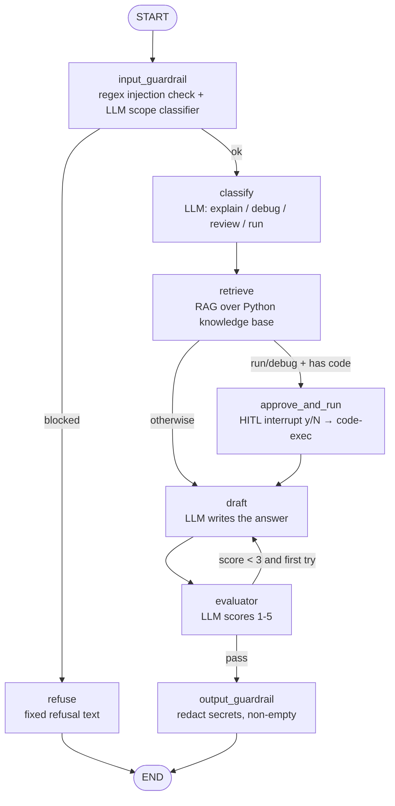

# PyMentor — a Python Tutor Agent (LangGraph + OpenRouter)

**PyMentor** is an AI agent with one focused job: **helping beginner programmers with Python**.
It explains Python concepts, explains and fixes Python errors, reviews code, and can run
Python code (only after you approve it) so its explanation is based on the *real* output.
Anything that is not about Python is politely refused.

- **Framework:** LangGraph (workflow) + LangSmith (monitoring)
- **LLM provider:** OpenRouter (free models by default, paid models supported)
- **Interface:** interactive CLI → packaged as `agent.exe` (see Releases)

---

## 1. Quick start

### Option A — run the exe (Windows)
1. Download `agent.exe` from the repository's **Releases** page.
2. Put a `.env` file next to it (copy `.env.example` and fill in your keys), **or** just run
   it: if no key is found, it asks for your OpenRouter key (hidden input).
3. Double-click `agent.exe` or run it from a terminal.

> Running code requires Python installed on the computer (the exe looks for `python` on PATH).

### Option B — run from source
```bash
python -m venv .venv
.venv\Scripts\activate          # Windows   (Linux/macOS: source .venv/bin/activate)
pip install -r requirements.txt
copy .env.example .env          # Linux/macOS: cp .env.example .env  — then add your keys
python main.py
```

### Keys
| Variable | Required | Where to get it |
|---|---|---|
| `OPENROUTER_API_KEY` | yes | https://openrouter.ai/keys (free) |
| `LANGSMITH_API_KEY` + `LANGSMITH_TRACING=true` | for monitoring | https://smith.langchain.com |

Never commit your real `.env` — it is in `.gitignore`.

---

## 2. Using the CLI

Type a question and press Enter. Commands:

| Command | What it does |
|---|---|
| `help` or `?` | short usage guide |
| `file <path>` | attach a local `.py/.txt/.md/.log` file (drag-and-drop the file into the terminal works) |
| `file` / `clear` | show / detach the attached file |
| `model` / `model <id>` | show / switch the OpenRouter model |
| `models` | list the free models available on OpenRouter right now |
| `tools` | show the active extensions |
| `cost` | tokens and cost used in this session (actual + theoretical) |
| `summary` | **(bonus)** save a summary of the conversation to `pymentor_summary_<time>.txt` |
| `exit` / `quit` | leave |

Multi-line code: paste it between ```` ``` ```` lines, or attach it as a file.

Example session:
```text
You> file C:\homework\ex1.py
Attached ex1.py (3 lines). Now ask a question about it, e.g. 'why does this crash?'
You> why does this crash?
[INFO] Entering Node: Input_Guardrail (safety + scope check)
[INFO] Entering Node: Classify (what kind of request)
[INFO] Entering Node: Retrieve (RAG knowledge search)
[INFO] RAG found: IndexError: list index out of range, Loops: for, while, range
[INFO] Entering Node: Approve_And_Run (HITL + code execution)

=== Approval needed: PyMentor wants to RUN this code ===
nums = [1, 2, 3]
print(nums[3])
========================================================
Run this code on your computer? [y/N]: y
[INFO] Entering Node: Draft (writing the answer)
[INFO] Entering Node: Evaluator (quality check)
[INFO] Evaluator score: 5/5
[INFO] Entering Node: Output_Guardrail (final safety check)

--- Real output of your code ---
[exit code 1]
IndexError: list index out of range

PyMentor:
...
```

Errors are shown as clear one-line messages (`[ERROR] ...`) — e.g. a wrong API key, a model
that is no longer free, a rate limit, no internet, a missing file. The CLI never crashes on
a single bad turn. Set `PYMENTOR_DEBUG=1` to see full technical details.

---

## 3. Architecture

### The LangGraph workflow


| Component | Required by assignment | Where |
|---|---|---|
| Specific task (not a general chat) | ✔ | Python tutoring only — `agent/nodes.py` prompts |
| LangGraph nodes + edges | ✔ | `agent/graph.py` |
| OpenRouter (free / paid) | ✔ | `agent/llm.py` (OpenAI-compatible API via `langchain-openai`) |
| **GuardRails** | ✔ | `input_guardrail` (prompt-injection regex, length, LLM scope check), `output_guardrail` (secret redaction) |
| **Gates** | ✔ | conditional edges: blocked→refuse; code-exec only for run/debug with code; quality gate after evaluator |
| **Evaluator** | ✔ | `evaluator` node (LLM-as-judge inside the graph, max 1 rewrite) |
| **HITL** | ✔ | `approve_and_run` uses LangGraph `interrupt()`; CLI asks `[y/N]` and resumes with `Command(resume=...)` |
| Extensions | ✔ | **RAG** (`tools.search_knowledge`) + **Code-Exec** (`tools.run_python_code`) |
| LangSmith monitoring | ✔ | automatic tracing of every graph run when `LANGSMITH_TRACING=true` |
| Streaming of current node | ✔ | `agent/runner.py` uses `graph.stream(stream_mode="tasks")` → `[INFO] Entering Node: ...` |

### LLM tasks inside the agent
Classification (scope check, intent), drafting (answer writing), evaluation (scoring the
draft), and summarization (`summary` command).

### Key design decisions (and why)
- **JSON-in-prompt instead of tool-calling.** Many free OpenRouter models do not support
  tool-calling / structured output, so classifier and judge nodes ask for JSON and parse it
  tolerantly, with a safe fallback when the model returns garbage.
- **Deterministic guardrail first, LLM second.** Prompt-injection patterns are blocked by
  regex *before* any model call: it costs nothing and cannot be "talked out of" its rule.
- **Fixed refusal text.** Refusals are not generated by the LLM, so they never leak content
  and the scope eval can measure them reliably.
- **Bounded quality loop.** The evaluator can request at most one rewrite, so cost and time
  per question are bounded.
- **Lexical RAG (BM25), not embeddings.** No embedding cost, works offline, deterministic and
  testable. Python error names appear verbatim in tracebacks, so keyword search fits well.
  Tradeoff: weaker on synonyms.
- **Free-model resilience.** OpenRouter retires free models often. If the chosen free model is
  gone or rate-limited, the agent falls back to other free models and finally to
  `openrouter/free` (OpenRouter's free-model router). `models` lists what is free *today*.
- **Code-exec is a restricted subprocess, not a full sandbox.** Timeout (10s), isolated mode
  (`python -I`), temporary folder, minimal environment, output cap — **and the user must
  approve every run** after seeing the code and warnings for risky operations (deleting
  files, shell commands, network). A container would be stronger isolation; it was not used
  to keep the exe simple to install.

### Project structure
```
my-llm-agent/
├── agent/
│   ├── __init__.py
│   ├── graph.py        # LangGraph workflow definition
│   ├── nodes.py        # nodes: guardrails, classify, RAG, HITL, draft, evaluator
│   ├── tools.py        # extensions: RAG search, code execution, local file input
│   ├── cli.py          # CLI entrypoint
│   ├── llm.py          # OpenRouter connection, fallback, friendly errors
│   ├── runner.py       # one turn: streaming + HITL resume loop (shared by CLI and evals)
│   ├── pricing.py      # OpenRouter prices, actual + theoretical cost
│   └── knowledge.py    # the RAG knowledge base
├── evals/
│   ├── compare_models.py   # eval 1: model comparison (LLM-as-judge)
│   ├── cost_eval.py        # eval 2: cost per step + total
│   ├── scope_eval.py       # eval 3: professionalism & no-leakage (refusal rate)
│   ├── rubric.md           # rubric for the LLM judge
│   ├── common.py           # shared eval helpers
│   └── results/            # CSV outputs
├── tests/              # offline tests (fake model, no API key needed)
├── main.py             # PyInstaller entry point
├── manifest.json
├── requirements.txt
├── README.md
└── .env.example
```

---

## 4. Evals

Run from the project folder (needs `OPENROUTER_API_KEY` in `.env`):
```bash
python evals/compare_models.py
python evals/cost_eval.py
python evals/scope_eval.py
```
Each writes its own CSV to `evals/results/`.
If a free model is rate-limited, the scripts wait and retry (up to 3 times). A question
that still fails is reported as an error and never counted as a wrong answer or a missed
refusal; the scope eval then says `INCOMPLETE` instead of `PASS`/`FAIL`.

| Eval | What it checks | How it is measured | Output |
|---|---|---|---|
| 1. Model comparison | Same 3 tasks on different models | Time measured automatically; quality, data quality and reliability by **LLM-as-judge** with one **fixed** judge model and the rubric in [`evals/rubric.md`](evals/rubric.md) | `compare_models.csv` |
| 2. Cost | 4 common tasks on free + paid models | `price × tokens` per graph node + total per task + grand total; for free models the **actual** cost (0) next to the **theoretical** cost (the paid twin's price, or a labelled reference rate) | `cost_eval.csv` |
| 3. Professionalism & no-leakage | 18 out-of-scope questions — the store's own 8 Hebrew probes from `policy.json`, 8 more, and 2 injection attempts — plus 4 valid controls | **refusal rate** (% correctly refused), false-refusal rate, and PASS/FAIL against the store's 80% bar | `scope_eval.csv` |

Models are configurable in `.env` (`EVAL_FREE_MODELS`, `EVAL_PAID_MODELS`, `JUDGE_MODEL`).
The defaults use `openai/gpt-4o-mini` as the paid model and the judge — the whole eval run
costs a few cents of OpenRouter credit.

---

## 5. Tests
```bash
pip install -r requirements-dev.txt
python -m pytest
```
47 offline tests use a fake model (no key, no cost): the full graph path, refusals,
injection blocking, HITL approve/decline, the rewrite loop, secret redaction, model
fallback, code execution (errors, timeouts, output cap), file validation, pricing,
all three eval scripts producing their CSVs, and the Safe-Agents platform contract
(`messages` state, approval format, two turns on one thread, file paths in messages).

---

## 6. Building `agent.exe` and publishing a Release

Automatic (recommended): on GitHub, open **Releases → Draft a new release**, create a tag
matching `version` in `manifest.json` (e.g. `v1.0.1`), and click **Publish release**.
The workflow `.github/workflows/release.yml` then runs the tests, builds `agent.exe` on
Windows with PyInstaller, smoke-tests it, and attaches `agent.exe`, `pymentor-agen.zip`
and its sha256 to the Release (about 3 minutes).

Manual (on a Windows computer):
```bash
pip install -r requirements-dev.txt
pyinstaller --onefile --console --name agent --collect-submodules langgraph --collect-submodules langchain_openai main.py
```
The exe is created at `dist\agent.exe`. Upload it on GitHub → Releases → *Draft a new release*.

---

## 7. Safe-Agents store compatibility

The agent follows the [Safe-Agents agent contract](https://github.com/SafeAI613/Safe-Agents/blob/main/docs/AGENT_CONTRACT.md):

| Contract rule | How PyMentor meets it |
|---|---|
| `manifest.json` with a `runtime` block | validated against `schemas/manifest.schema.json` (0 errors) |
| `graph_entry` = `agent/graph.py:graph`, no custom checkpointer | module-level `graph = builder.compile()` |
| No LLM client or key reading at import time | the client is created inside the nodes |
| State contains `messages` | input is read from the last user message; the answer is appended as an AI message |
| HITL via `interrupt()` with `{"type": "approval", ...}` | resumes with `{"approved": bool, "edited": ...}` (the CLI's `y`/`n` also works) |
| Cost from `usage_metadata` | the final AI message carries the turn's total tokens; `stream_usage=True` |
| Files arrive as a path inside the message | the path is detected and the file is read |
| Source zip as a Release asset | the release workflow uploads `pymentor-agen.zip` and its sha256 |
| No hard-coded keys | the repo passes the store's key-pattern scan |

## 8. Limitations (honest list)
- Free models change and can be slow or rate-limited; the agent falls back automatically, but
  answer quality depends on the model.
- Code-exec is a restricted subprocess protected by human approval, not a security sandbox.
- The RAG knowledge base is small (22 notes) and keyword-based.
- No long conversation memory (each question is independent) — by design, per the assignment.
